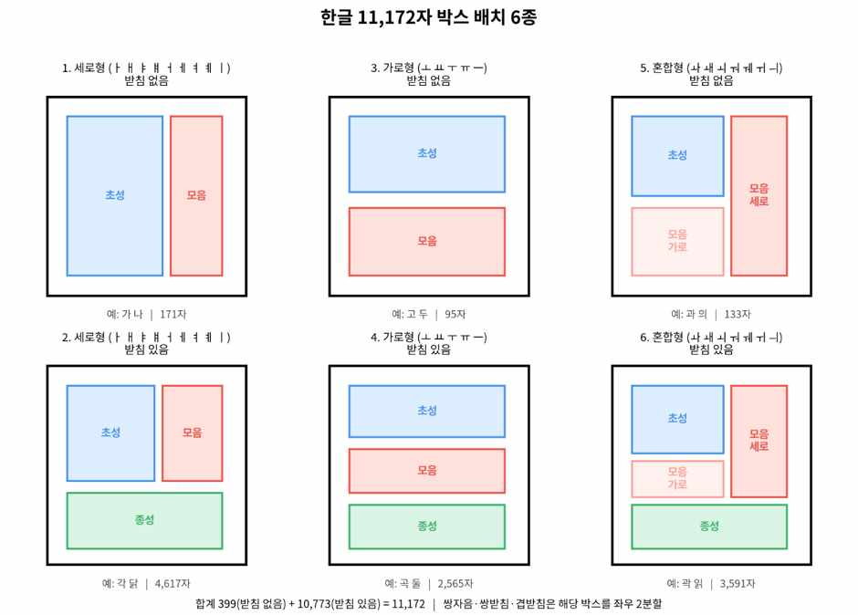
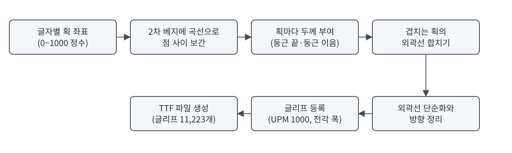
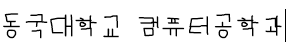
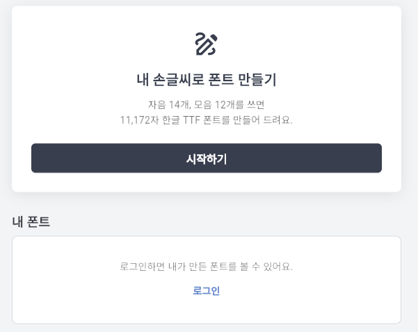
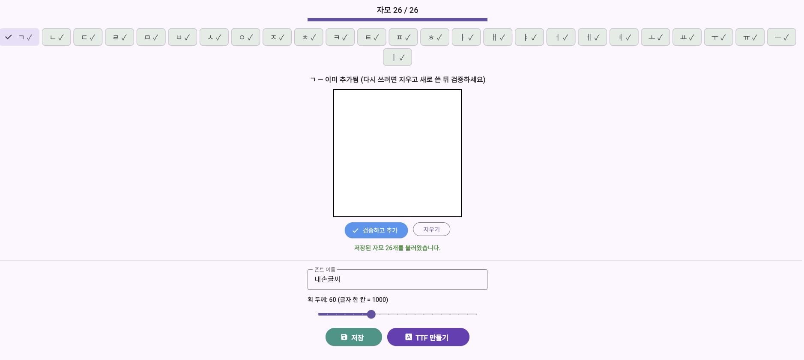
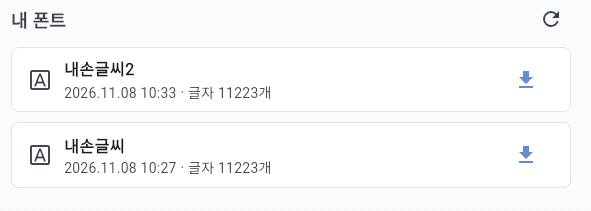
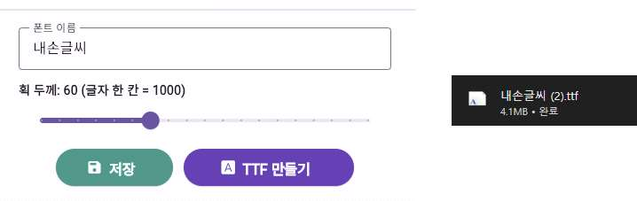
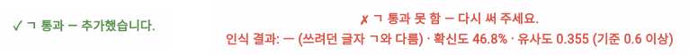
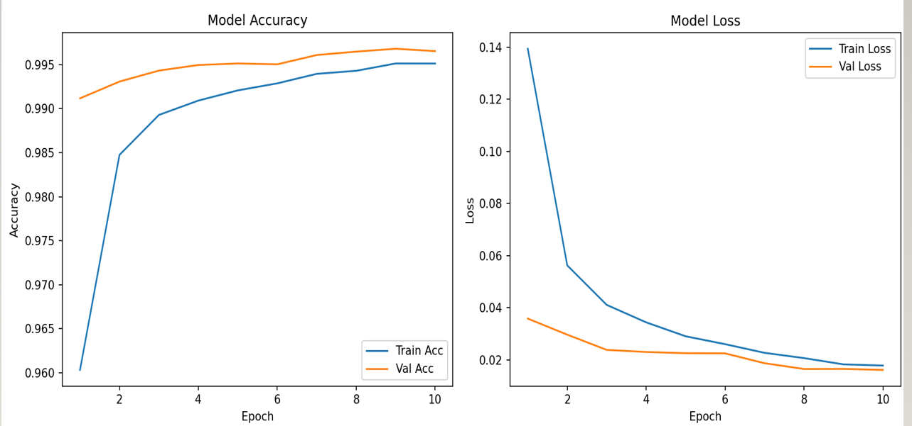

# ✍️ My Handwriting Font

**자모 단위 필기 획 합성 기반 개인 맞춤형 한글 폰트 생성 응용 프로그램**

사용자가 직접 쓴 한글 자모(자음·모음)를 수집하고, AI 모델로 글씨를 검증한 뒤, 자모를 조합해 **나만의 한글 폰트(TTF)** 를 만들어 주는 시스템입니다.

 

## 📌 프로젝트 소개

한글 폰트를 하나 만들려면 수천 개의 완성형 글자를 디자인해야 합니다. 이 프로젝트는 한글이 자음과 모음의 조합으로 이루어진다는 점에 착안해, 사용자가 **기본 자모 26개(자음 14개 + 모음 12개)** 만 쓰면 나머지 글자를 규칙에 따라 합성해 폰트를 만들어 냅니다.

- **손글씨 입력**: 태블릿에서 자모를 직접 쓰면 획의 좌표와 필압 데이터를 서버로 전송
- **AI 검증**: CNN 모델로 어떤 글자인지 분류하고, 코사인 유사도로 글씨 품질을 판단해 기준을 통과한 글씨만 저장
- **자모 파생**: 쌍자음(ㄲ, ㄸ …), 겹받침(ㄳ, ㄺ …), 합성 모음(ㅘ, ㅝ …)은 따로 쓰지 않고 사용자가 쓴 기본 자모로 생성
- **글자 합성**: 6가지 배치 유형(세로형 / 가로형 / 혼합형 × 받침 유무)에 맞춰 자모의 크기와 위치를 조정해 완성형 글자 생성
- **폰트 생성**: 합성된 11,172자로 TTF 폰트 파일 생성
- **회원 관리**: Gmail 이메일 인증 기반 회원가입 및 로그인

 

## 🏗️ 시스템 구조

1. Flutter 웹 앱에서 사용자가 자모를 쓰면 획 좌표를 Spring 서버로 보냅니다.
2. Spring은 FastAPI 서버에 검증을 요청하고, 결과를 받아 두 가지 조건을 모두 만족할 때만 DB에 저장합니다.
   - 쓰려던 글자와 모델이 분류한 글자가 일치하는가
   - 코사인 유사도가 기준값(0.6) 이상인가
3. 폰트 생성을 요청하면 Spring이 DB에서 사용자의 자모를 불러와 FastAPI에 전달하고, FastAPI가 6가지 배치 규칙으로 글자를 합성해 TTF 파일을 만듭니다.

  
   음절 배치 틀 6가지

  
   TTF 생성 과정

 

## 📊 결과

### 폰트 생성 결과

자모 26자만 입력해 **11,223개 글리프**(현대 한글 11,172자 + 호환용 자모 51자)를 실패 없이 생성했습니다.

| 항목 | 결과 |
| --- | --- |
| 입력한 자모 | 26자 (자음 14 + 모음 12) |
| 생성된 글리프 | 11,223개 |
| 생성에 실패한 글자 | 0자 |
| 음절 배치 시간 | 약 0.8초 |
| 전체 생성 시간 | 약 13.4초 |
| TTF 파일 크기 | 4.1MB |
| CNN 검증 정확도 | 99.61% |

### 생성된 폰트로 쓴 문서

  

### 실행 화면

<table>
  <tr>
    <td align="center"> 메인 화면</td>
    <td align="center"> 폰트 만들기 화면 (자모 26자 입력)</td>
  </tr>
  <tr>
    <td align="center"> 내 폰트 목록</td>
    <td align="center"> 폰트 이름·획 두께 설정 및 생성 완료</td>
  </tr>
</table>

### 자모 검증

  
   왼쪽: 통과 / 오른쪽: 실패 (인식 결과와 유사도를 함께 표시)

### CNN 학습 결과

Kaggle 한글 음절 데이터를 자모 단위로 나눈 26만 장으로 학습했습니다 (64×64, 10 epoch).

  
   CNN 학습 정확도와 손실 (검증 정확도 99.61%)

 

## 📂 Repositories

| Repository | 설명 | 기술 스택 |
| --- | --- | --- |
| [handwriting-frontend](https://github.com/my-handwriting-font/handwriting-frontend) | 손글씨 입력, 검증 결과 확인, 폰트 생성 화면을 제공하는 웹 앱 (iPad Safari) | Flutter, Dart |
| [handwriting-backend](https://github.com/my-handwriting-font/handwriting-backend) | 회원 관리, 자모 데이터 저장, AI 서버 연동을 담당하는 API 서버 | Spring Boot, JPA, MySQL |
| [handwriting-fastapi](https://github.com/my-handwriting-font/handwriting-fastapi) | CNN 기반 자모 분류, 코사인 유사도 검증, 글자 합성 및 TTF 생성 서버 | FastAPI, Python, CNN |

 

## 🛠️ Tech Stack

| 구분 | 기술 |
| --- | --- |
| Frontend | Flutter, Dart |
| Backend | Spring Boot, JPA, MySQL |
| AI Server | FastAPI, Python, PyTorch, shapely, fontTools |

 

## 👤 Developer

**안태후** · 1인 개발 (기획, Flutter 앱, Spring Boot 서버, FastAPI 서버, DB 설계)

동국대학교 WISE캠퍼스 컴퓨터공학과 졸업작품
